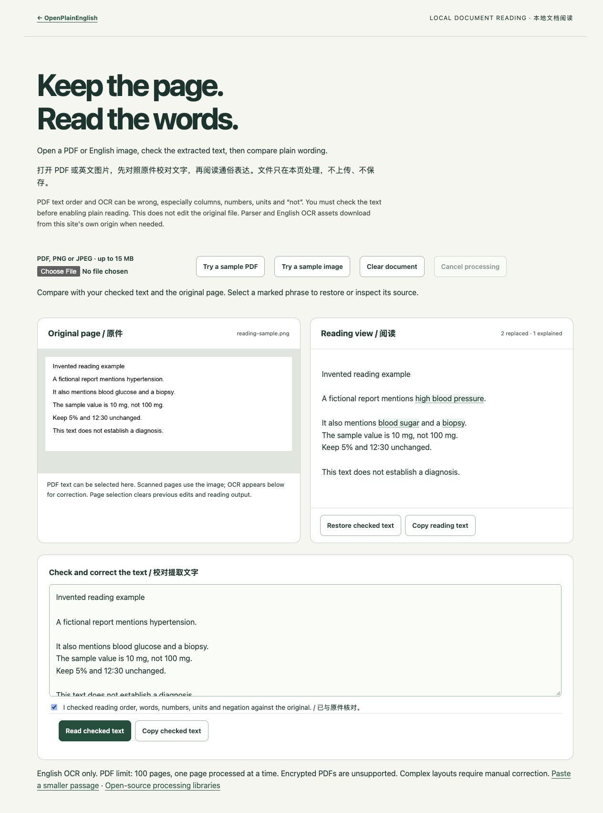

# OpenPlainEnglish

让专业语言更容易理解，让普通人也能平等地获取信息。

OpenPlainEnglish 是一个开源的英文健康阅读辅助工具。主动开启**整页就地白话替换**后，经过单独核对的术语会直接变成更常见的表达，例如 `hypertension → high blood pressure`。点击可对照原词、查看释义与来源，也可以恢复原文。没有合适替换的词保留原文并提供解释。v0.5 的默认词库包含 **132 个健康词条，其中 30 个词条提供 56 组明确替换**；有释义不等于能直接替换，处理在本机完成。

[安装 OpenPlainEnglish](https://jakezwang.github.io/openplainenglish/demo/install.html) · [在线演示](https://jakezwang.github.io/openplainenglish/) · [English README](README.md) · [更新与反馈恢复](docs/UPGRADING.md)

[一分钟操作演练](https://jakezwang.github.io/openplainenglish/demo/guide.html) · [粘贴段落](https://jakezwang.github.io/openplainenglish/demo/workbench.html) · [本地 PDF／英文图片](https://jakezwang.github.io/openplainenglish/demo/documents.html) · [句子拆分实验](https://jakezwang.github.io/openplainenglish/demo/sentences.html)

工具已有单处还原、本页忽略、中英界面、阅读偏好与快捷键、跨行内标签识别和原词对照。v0.5 增加首次使用演练、可选的同源内嵌页面与开放组件读取，以及独立的文档工具和有限句子实验。8 个公共服务词条可在段落工具或 SDK 中单独选用，不混入默认健康词库。Firefox 提供未签名的独立开发预览包；各浏览器仍需实际安装验收，详见[支持范围](docs/BROWSERS-AND-SURFACES.md)。



*上图为 v0.5 文档阅读页的虚构图片示例。网页演示和模拟浏览器接口不能证明真实扩展安装、权限或升级已通过验收。v0.5 的实际结果与未完成项见[版本验证记录](docs/RELEASE-0.5.0.md)；真实参与者研究仍未开展。*

## 安装

[打开安装页面](https://jakezwang.github.io/openplainenglish/demo/install.html)。**商店安装尚未上线**，还需要开发者账号注册和商店审核；上线后这里会连接已验证的官方商店地址，由浏览器确认安装。下载 ZIP 本身不会安装扩展。

适用于桌面端 Chromium 浏览器，例如 Chrome、Edge；最低要求 Chromium 116。当前通过解压扩展安装，没有浏览器商店安装或自动更新。

1. 在 [Releases](https://github.com/jakezwang/openplainenglish/releases) 下载 `openplainenglish-版本号.zip`，不要选 GitHub 自动生成的 `Source code` 源码包。
2. 解压到一个准备长期保留的文件夹。里面应直接有 `manifest.json`。
3. Chrome 地址栏输入 `chrome://extensions`；Edge 输入 `edge://extensions`。
4. 开启「开发者模式」，选择「加载已解压的扩展程序」，选中包含 `manifest.json` 的文件夹。
5. 如有需要，把 OpenPlainEnglish 固定到浏览器工具栏。不要移动或删除正在使用的扩展文件夹。

这是安装操作说明，不代表已完成原生安装、权限、升级或导入验收。更新前先导出反馈 JSON，按[更新指南](docs/UPGRADING.md)保留备份。Firefox 的 `-firefox-preview.zip` 尚未签名，不是普通的一键安装包；SDK 的 `.tgz` 则是开发库，不是浏览器扩展。

## 使用

1. 打开普通的 HTTP 或 HTTPS 英文网页，点击工具栏中的 OpenPlainEnglish。
2. 默认选择 **Plain reading（白话阅读）**，点击 **Read in plain English**。界面分别显示替换了多少处、多少处保留原词并提供解释。
3. 点击带标记的词，或用 Tab 聚焦后按 Enter／空格，查看原词、替换表达、释义和来源。Escape 关闭解释。
4. 选择 **Explain terms（点击释义）** 可立即回到保留原词的阅读方式。关闭状态下选模式不会自动开启。
5. 点击 **Restore original（恢复原文）** 关闭。工具未被网页修改的替换会恢复成原先的文字，网站自己更新的内容会保留。刷新页面或进入新的页面文档后，需要重新开启。

首次使用可以从弹窗或词库打开**阅读演练**，练习开启、查看原词、仅此处恢复原词和关闭。演练只改变自己的示例，完成后由你选择在本机记住；不会自动开启其他网页，也不会记录操作历史。之后随时可以重做。

在 **Reading preferences（阅读偏好）** 中可选择中英界面、宽松／紧凑布局、柔和／醒目标记和阅读模式。界面语言不会翻译英文词库或网页。七项设置保存在本机：上述四项、两个额外读取开关和演练完成状态；反馈 JSON 不包含这些设置。旧版本首次升级时，新增开关和完成状态默认关闭。Ctrl+Shift+L 切换阅读，Ctrl+Shift+U 恢复原文；macOS 使用 Control。若发生快捷键冲突，可在浏览器扩展快捷键设置中调整。

替换使用专门核对的词形与短语，不会把整段词典定义塞进正文，也不是全文翻译或通用句子改写。可替换的具体词形、例句、排除原因见[替换词库说明](docs/INLINE-LEXICON.md)。词库搜索也支持白话表达。普通复制和浏览器查找使用当前显示的文字；需要原文时先对照或恢复。

**Explore the glossary** 可以搜索完整词库。扩展不读取浏览器内部页面、本地文件或浏览器内置 PDF 查看器。短语可跨支持的粗体、斜体等行内标签，复杂或交互元素会截断匹配。表单、编辑区、链接、按钮、代码、隐藏内容和明确标记为非英文的段落会跳过。

额外读取默认关闭。主动勾选后，可包含当前页面中**可访问的同源 iframe** 和 **开放的 Shadow DOM 组件**，不会申请额外网站权限或修改 sandbox。跨域／无法访问的内嵌页面、封闭组件仍会跳过。最多增加 32 个可访问范围，与主文档共享扫描和标记预算；大页面可能只检查一部分。已存在的组件之后才创建影子根时，可能需要关闭后重新开启阅读。开启设置本身不会开启阅读。

## 读 PDF、图片或自己的段落

[段落工具](https://jakezwang.github.io/openplainenglish/demo/workbench.html)可粘贴英文，比较原文和阅读视图，分别复制并清除。原位替换仍只覆盖已核对的词语，不会生成新的事实或建议。

[文档工具](https://jakezwang.github.io/openplainenglish/demo/documents.html)是独立网页功能：选择 PDF、PNG 或 JPEG，保留可见原件，用 PDF.js 提取文字或用 Tesseract 做**本地英文 OCR**。先核对阅读顺序、文字、数字、单位及否定词，再勾选确认并开启白话阅读。OCR 置信度不等于准确率，多栏排版和扫描文字尤其需要校对。

限制为单文件 15 MB、PDF 最多 100 页、单张处理图像 2,000 万像素、提取文字 20,000 字符；一次处理一页，加密 PDF 不支持。换页会清除前页校对内容和阅读结果。Clear／Cancel 会清除本页持有的文档与文字，不修改原文件。文件与结果不上传或持久化；解析器、工作线程、字体和英文识别模型会按需从网站同源下载，不使用远端识别服务。这些 PDF/OCR 依赖不进入扩展或 SDK。

[句子实验](https://jakezwang.github.io/openplainenglish/demo/sentences.html)只尝试把符合窄规则的一处分号拆成句号，并调整首字母大小写。它保留词语与数字顺序，显示差异，要求核对后采用，并可恢复精确原文；不调用模型、不上传或保存文字，也不保证语义等价。含引号的输入会保留；复杂结构可能没有建议。

## 反馈、备份与恢复

解释面板中的反馈入口会打开 **Your feedback**。填写内容后，**Save local draft** 只保存在本机，没有发送给维护者。

- **Export JSON**：把本地草稿导出为备份文件。
- **Import JSON**：在 v0.2 及之后版本中恢复备份，兼容 v0.1 的导出格式。先查看数量、内容和可能超出容量的草稿，再点击 **Merge local drafts** 确认合并。取消不会修改草稿。
- **Review & share**：先核对报告，再决定如何分享。**Open GitHub draft** 会打开 GitHub 草稿，在 GitHub 提交后才成为公开 issue。
- **Copy report／Download report**：查看同一份分享预览后，可复制或下载文字报告；不需要 GitHub 账号，也不会自动发送给任何人。
- **Open email draft**：仅在项目配置了有效接收邮箱时出现，先显示收件人、主题和完整正文，再由你选择交给邮件应用。当前邮箱配置为 `null`，没有可接收反馈的邮件地址；复制和下载仍可使用。工具不会自动发送邮件。
- **Delete／Delete all**：确认后删除本地草稿，不会删除已导出的文件或公开的 GitHub issue。

本地最多保留 100 条草稿。导入时，相同 ID 优先保留本地草稿，其余按创建时间保留最新 100 条；同一时间按 ID 确定顺序。界面会显示被跳过的重复项，以及因容量限制无法保留的项。导入接受不超过 1 MiB、最多 1,000 条的有效反馈 JSON 备份；不符合格式的文件会整体拒绝。完整步骤见[更新指南](docs/UPGRADING.md)。

下载的单份 `.txt` 报告不能作为 JSON 备份导入。复制或下载也不等于维护者收到了反馈，需要你自行选择接收方并分享。

## 隐私与边界

没有账号、遥测、远程模型或自动上传。匹配和解释使用随扩展提供的词库；反馈不会自动附带网页正文、标题、网址或浏览历史。扩展只申请 `activeTab`、`scripting`、`storage`，没有申请长期读取所有网站的权限。

导入、导出和本地保存不向 GitHub 发送数据。主动打开 GitHub 草稿时，预填文字会通过网址传给 GitHub，也可能留在浏览历史中；不必等到公开提交才发生传输。配置邮箱后，打开邮件草稿会把报告交给邮件处理器，邮件应用可能在发送前同步草稿。公开网站的托管方还会收到正常页面和软件资源请求。请在分享前移除个人病历、身份和账户信息。本地存储不是加密保险箱，也没有账号同步。详见[隐私政策](docs/PRIVACY.md)。

**Source-checked（已对照来源）**表示项目释义曾与引用资料对照。初始释义由 AI 辅助撰写，未经过独立临床审核，也没有真实参与者的理解测试结果。它解释词语，不判断你是否患病，不解读个人病历，也不替代医疗建议。词库不会自动理解否定、所有上下文或个人情况。独立文档 OCR 也不验证医学含义或识别准确性。

已有[原文／点词解释／原位替换的试测工具与材料](docs/USER-TESTING.md)，但真实参与者为 **0**。是否比查词更有帮助，需要通过理解正确率、完成时间、误解和原文恢复能力来验证，不能用软件测试或词条数量替代。原生扩展权限、升级、文件导入及商店验收也仍待完成。

释义参考公开来源。CDC、NIH/NLM/NCI、FDA 和美国政府没有为 OpenPlainEnglish 背书。[词库说明](docs/LEXICON.md)记录了来源、许可和审核方式。

## 从源码运行

安装 Node.js 22 或 24，在项目目录执行：

```sh
npm ci
npm run check
npm run package
```

浏览器「加载已解压的扩展程序」可选择生成的 `dist/`。`npm run dev` 启动网页演示并打印本地地址。测试实际扩展时，保持网页演示自带的 reader 关闭，通过浏览器工具栏开启扩展，避免重复运行。

`npm run package:firefox` 构建未签名 Firefox 预览；`npm run package:sdk` 构建独立引擎与词库 tarball，尚未发布到 npm。SDK 提供文本引擎、DOM 阅读器、有限句子拆分，以及文档提取／边界检查 helper；这些 helper 本身不解析 PDF 文件或执行 OCR，详见[SDK 文档](docs/SDK.md)。[P0–P2 完成记录](docs/BACKLOG.md)与[版本验证记录](docs/RELEASE-0.5.0.md)分别列出工作进展和证据边界。

软件采用 [MIT](LICENSE) 许可，项目原创词库采用 [CC0](data/LICENSE)。欢迎提交你读不懂的词、释义建议、来源修正和可访问性问题，不需要专业资质或编程经验。[贡献指南](CONTRIBUTING.md) · [安全问题](SECURITY.md)
