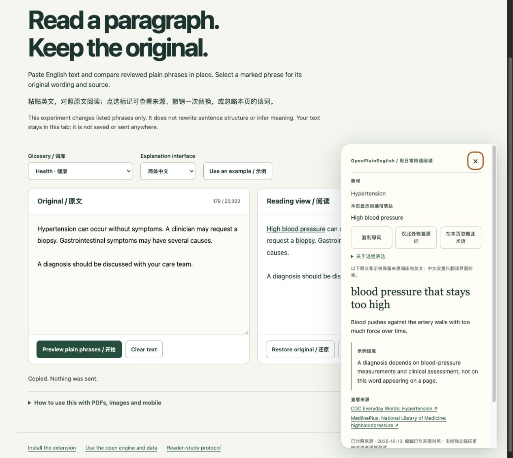

# OpenPlainEnglish

让专业语言更容易理解，让普通人也能平等地获取信息。

OpenPlainEnglish 是一个开源的英文医疗阅读辅助工具。v0.4 加入**整页就地白话替换**：你主动开启后，经过单独核对的术语会直接变成更常见的表达，例如 `hypertension → high blood pressure`。点击可对照原词、查看释义与来源，也可以一键恢复。没有合适替换的词保留原文并提供解释。目前词库包含 112 个英文医疗词条，处理在本机完成。

[安装 OpenPlainEnglish](https://jakezwang.github.io/openplainenglish/demo/install.html) · [在线演示](https://jakezwang.github.io/openplainenglish/) · [English README](README.md) · [更新与反馈恢复](docs/UPGRADING.md)

[粘贴自己的段落试用](https://jakezwang.github.io/openplainenglish/demo/workbench.html) · [可复用引擎与词库](docs/SDK.md) · [P0–P2 完成记录](docs/BACKLOG.md)

v0.4 进一步加入：单次撤销、本页忽略、中英界面、阅读偏好与快捷键、跨行内标签识别、复制原词和打印原文。公共服务用语试验可在段落页单独选用，不会混入默认医疗词库。Firefox 提供独立开发预览包；各浏览器仍需实际安装验收，详见[支持范围](docs/BROWSERS-AND-SURFACES.md)。



*截图来自网页演示。网页演示及模拟浏览器接口的预览，不能证明真实扩展的安装、权限和消息处理已通过验收；请查看相应版本的验证记录。*

## 安装

[打开安装页面](https://jakezwang.github.io/openplainenglish/demo/install.html)。**商店安装尚未上线**，还需要开发者账号注册和商店审核；上线后这里会连接已验证的官方商店地址，由浏览器确认安装。下载 ZIP 本身不会安装扩展。

适用于桌面端 Chromium 浏览器，例如 Chrome、Edge；最低要求 Chromium 116。当前通过解压扩展安装，没有浏览器商店安装或自动更新。

1. 在 [Releases](https://github.com/jakezwang/openplainenglish/releases) 下载 `openplainenglish-版本号.zip`，不要选 GitHub 自动生成的 `Source code` 源码包。
2. 解压到一个准备长期保留的文件夹。里面应直接有 `manifest.json`。
3. Chrome 地址栏输入 `chrome://extensions`；Edge 输入 `edge://extensions`。
4. 开启「开发者模式」，选择「加载已解压的扩展程序」，选中包含 `manifest.json` 的文件夹。
5. 如有需要，把 OpenPlainEnglish 固定到浏览器工具栏。不要移动或删除正在使用的扩展文件夹。

## 使用

1. 打开普通的 HTTP 或 HTTPS 英文网页，点击工具栏中的 OpenPlainEnglish。
2. 默认选择 **Plain reading（白话阅读）**，点击 **Read in plain English**。界面分别显示替换了多少处、多少处保留原词并提供解释。
3. 点击带标记的词，或用 Tab 聚焦后按 Enter／空格，查看原词、替换表达、释义和来源。Escape 关闭解释。
4. 选择 **Explain terms（点击释义）** 可立即回到保留原词的阅读方式。关闭状态下选模式不会自动开启。
5. 点击 **Restore original（恢复原文）** 关闭。工具未被网页修改的替换会恢复成原先的文字，网站自己更新的内容会保留。刷新页面或进入新的页面文档后，需要重新开启。

替换使用专门核对的词形与短语，不会把整段词典定义塞进正文。它不是全文翻译或句子改写工具，也不能理解所有语境。可替换的具体词形、例句、排除原因见[替换词库说明](docs/INLINE-LEXICON.md)。词库搜索也支持白话表达。

**Explore the glossary** 可以搜索完整词库。工具不会解释图片、PDF、浏览器内部页面、本地文件、iframe 或 shadow root 中的文字；短语可跨支持的粗体、斜体等行内标签，复杂或交互元素会截断匹配。表单、编辑区、链接、按钮、代码、隐藏内容和明确标记为非英文的段落会跳过。大页面可能只标记一部分，界面会说明。

## 反馈、备份与恢复

解释面板中的反馈入口会打开 **Your feedback**。填写内容后，**Save local draft** 只保存在本机，没有发送给维护者。

- **Export JSON**：把本地草稿导出为备份文件。
- **Import JSON**：在 v0.2 及之后版本中恢复备份，兼容 v0.1 的导出格式。先查看数量、内容和可能超出容量的草稿，再点击 **Merge local drafts** 确认合并。取消不会修改草稿。
- **Review & share on GitHub**：先核对将要分享的文字，再由你决定是否打开 GitHub 草稿；在 GitHub 提交后才成为公开 issue。
- **Copy report／Download report**：查看同一份分享预览后，可复制或下载文字报告；不需要 GitHub 账号，也不会自动发送给任何人。
- **Delete／Delete all**：确认后删除本地草稿，不会删除已导出的文件或公开的 GitHub issue。

本地最多保留 100 条草稿。导入时，相同 ID 优先保留本地草稿，其余按创建时间保留最新 100 条；同一时间按 ID 确定顺序。界面会显示被跳过的重复项，以及因容量限制无法保留的项。导入接受不超过 1 MiB、最多 1,000 条的有效反馈 JSON 备份；不符合格式的文件会整体拒绝。完整步骤见[更新指南](docs/UPGRADING.md)。

## 隐私与边界

没有账号、遥测、远程模型或自动上传。匹配和解释使用随扩展提供的词库；反馈不会自动附带网页正文、标题、网址或浏览历史。扩展只申请 `activeTab`、`scripting`、`storage`，没有申请长期读取所有网站的权限。

导入、导出和本地保存不向 GitHub 发送数据。你主动打开 GitHub 草稿时，预填文字会通过网址传给 GitHub，也可能留在浏览历史中；不必等到公开提交才发生传输。请在分享前移除个人病历、身份和账户信息。本地存储不是加密保险箱，也没有账号同步。详见[隐私政策](docs/PRIVACY.md)。

**Source-checked（已对照来源）**表示项目释义曾与引用资料对照。初始释义由 AI 辅助撰写，未经过独立临床审核，也未经过用户理解测试。它解释词语，不判断你是否患病，不解读个人病历，也不替代医疗建议。词库不会自动理解否定、所有上下文或个人情况，目前不包含法律、保险、食品、翻译和 OCR 功能。

释义参考公开来源。CDC、NIH/NLM/NCI、FDA 和美国政府没有为 OpenPlainEnglish 背书。[词库说明](docs/LEXICON.md)记录了来源、许可和审核方式。

## 从源码运行

安装 Node.js 22 或 24，在项目目录执行：

```sh
npm ci
npm run check
npm run package
```

浏览器「加载已解压的扩展程序」可选择生成的 `dist/`。`npm run dev` 启动网页演示并打印本地地址。测试实际扩展时，保持网页演示自带的 reader 关闭，通过浏览器工具栏开启扩展，避免重复运行。

软件采用 [MIT](LICENSE) 许可，项目原创词库采用 [CC0](data/LICENSE)。欢迎提交你读不懂的词、释义建议、来源修正和可访问性问题，不需要专业资质或编程经验。[贡献指南](CONTRIBUTING.md) · [安全问题](SECURITY.md)
