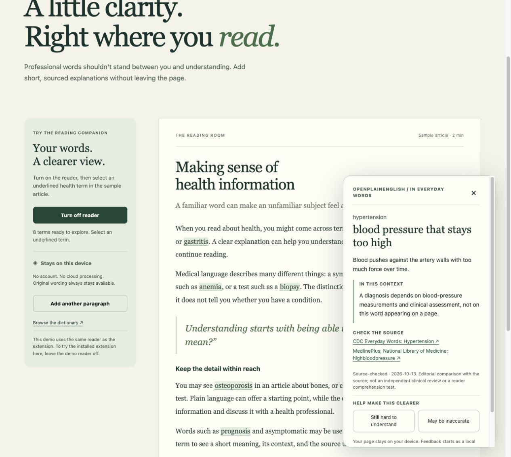

# OpenPlainEnglish v0.1.0 — verification record

Local verification date: **2026-10-13**. Scope: 100 English health entries, the shared reading interface, local feedback, and a Chromium extension package.

**The installed extension runtime has not been verified in a browser.** The results below distinguish the real shared reader on a localhost page from extension-page previews that use mock Chrome APIs.

*Chrome localhost demo using the shared reader. This screenshot is not evidence of an installed extension.*

## Verified locally

| Surface | Observed result |
| --- | --- |
| Automated tests | **48 tests passed**, covering matching, page handling, lexicon validation, feedback and background actions. These tests do not install the extension. |
| Shared reader in Chrome | Enabling marked **8 terms**. Opening a term displayed an accessible dialog with short meaning, explanation, context, sources and review status. Escape closed it. Adding the sample paragraph increased the count to **11**. Disabling returned the count to **0** and preserved the page wording. |
| Options UI with labeled mock Chrome adapter | Searching `hypertension` returned **1 of 100** entries; details and sources opened. The feedback form received the selected term, saved a local draft and retained it after reload. The explicit GitHub preview showed the intended issue text. **No issue was posted.** This uses separate demo-origin storage. |
| Packaging integrity | Final ZIP: **16 files, 176,203 bytes**. `unzip -t` passed for all files after the final source changes. Earlier independent checks verified safe paths, the exact asset allowlist, ZIP/dist byte equality and checksums. These checks do not demonstrate browser installation. |

The shared-reader verification followed fixes for a mutation-observer/status-render loop and placement of the accessible explanation panel in the document body.

Final ZIP SHA-256: `73928785612e7a61765b1adf374d303fab3aea1b94d2981be2c09f8eb5278400`.

The popup preview rendered correctly. Cancelling a local draft deletion preserved the draft. The dependency audit reported zero known vulnerabilities at verification time; this is not a security guarantee.

## Remaining verification and limitations

- Browser automation safety policy blocked access to `chrome://extensions`. No workaround was attempted. Loading the unpacked ZIP, real `activeTab` access, service-worker messaging, extension CSP enforcement and extension-storage persistence remain on the [manual checklist](TESTING.md#browser-checks-before-release).
- Edge, screen-reader use, and a complete narrow-screen/200%-zoom accessibility review are not verified in this record. A responsive layout and keyboard implementation do not establish accessibility certification.
- Definitions are AI-assisted original wording compared with cited sources. There has been no independent clinical review or reader-comprehension study.
- Matching is limited to supported English text nodes. It does not interpret records, negation or personal health status. PDFs, images, iframes, shadow roots, local files and browser-internal pages are unsupported; large pages can be partially marked.

At the time of this local record, GitHub Actions was pending the repository push. The [versioned release](https://github.com/jakezwang/openplainenglish/releases) should identify the final commit, CI result, ZIP and checksum. This local record does not claim that CI, publication or installed-runtime verification has completed.
