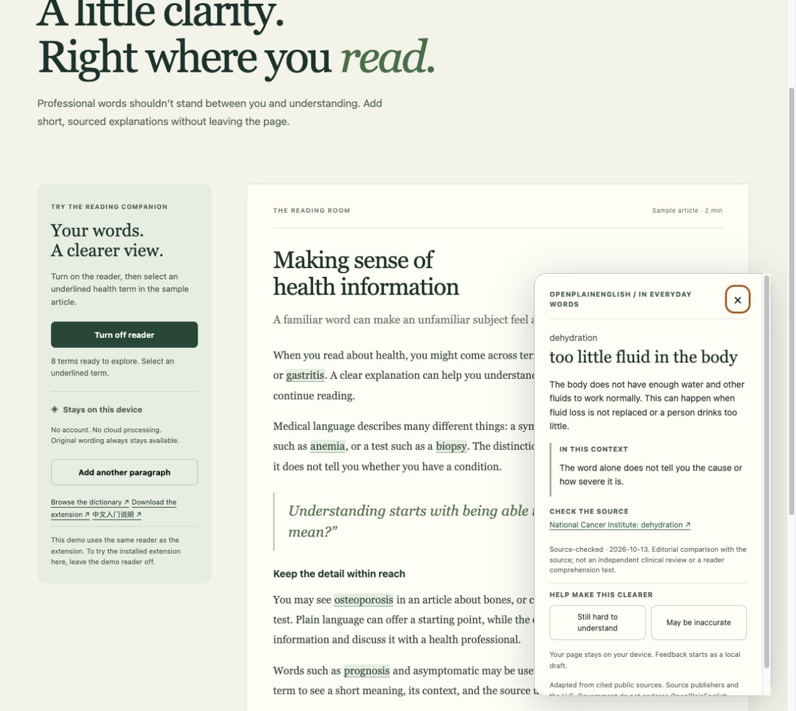

# OpenPlainEnglish v0.2.0 — verification record

Verification date: **2026-10-13**. This preview adds feedback backup restoration, a public demo, release/integration checks and contributor guidance. The lexicon still contains 100 English health entries.

**The installed extension runtime has not been verified in a browser.** Automated integration tests use mocked Chrome APIs; browser demo checks exercise the shared reader and labeled UI adapters.

## Verified locally

| Surface | Observed result |
| --- | --- |
| Automated checks | **79 tests passed**, followed by a successful extension build. Tests cover matching, DOM mutations and visibility, truncation budgets, malformed messages, local draft validation/import, lexicon structure, distribution and offline source-checker fixtures. |
| Bundled integration | Built popup, background and content code exchanged messages through a mocked Chrome host. Tests cover enable/disable, counts, explanations, feedback, import serialization and malformed/foreign messages. This does not establish native browser permission or service-worker behavior. |
| Shared reader in Chrome | The static site served under `/openplainenglish/` loaded its data and modules, marked terms, and opened the dehydration explanation with a keyboard action. The updated explanation, context and source links appeared in the dialog. |
| Feedback UI preview | A generated hypertension draft was saved locally. Chrome produced a real JSON download with schema version 1 and exactly the seven expected draft fields. No browsing URL, page title or page text was included. Import validation, inspectable preview, explicit confirmation, deduplication, overflow and cancellation passed automated UI/helper tests. |
| Distribution | The final ZIP contains **16 files, 195,300 bytes**. Build tests check the exact allowlist, safe paths, packaged asset bytes, deterministic output, checksum, versions, permissions and CSP declaration. Independent `unzip -t` passed for every file. |
| Source audit | All **105 unique cited URLs** returned available responses. Supplemental official API probes returned evidence for 91 CDC/NCI queries. See the [audit report](SOURCE-AUDIT.md) for query-match limitations and the two wording changes. |

ZIP SHA-256: `f9015f4d6b3c5fd6bf073457274e3e425f8a20a06248f80ad0313400873f64c0`.

The dependency audit reported zero known vulnerabilities at verification time. This is not a security guarantee.

## Publication

The [online demo](https://jakezwang.github.io/openplainenglish/) deployed successfully through [GitHub Actions run 38411556344](https://github.com/jakezwang/openplainenglish/actions/runs/38411556344). Node 22 and Node 24 both passed dependency installation, lexicon validation, all 79 tests, build, packaging, independent ZIP integrity and checksum checks before deployment. The checked implementation commit is `d0b34808405930ffdaf4976391e61f07a8a0ca9c`. The downloaded Node 22 CI artifact is byte-for-byte identical to the local release ZIP above. Later documentation-only commits add this verification record and screenshot without changing packaged files.

Chrome then loaded the public HTTPS URL successfully. Enabling the reader marked **8 terms**; a keyboard action opened the dehydration explanation with its revised wording, context and citation. Adding the sample paragraph increased the count to **11**. Disabling removed all term buttons and preserved the article's text exactly. No browser console errors were observed in that flow. The public dictionary route loaded edition **0.2.0** with 100 entries; searching `hypertension` returned one match. The feedback route showed its import/export controls and an empty, separate demo-origin draft store.

The [v0.2.0 preview release](https://github.com/jakezwang/openplainenglish/releases/tag/v0.2.0) distributes the ZIP, SHA-256 sidecar and machine-readable source audit. It remains an evaluation release with the limitations below.

## Remaining verification and limitations

- Browser automation policy blocked `chrome://extensions`; no workaround was attempted. Native installation, `activeTab` grants, service-worker lifecycle, enforced extension CSP and real extension-storage persistence remain on the [manual checklist](TESTING.md#browser-checks-before-release).
- The automation browser's file-upload permission was unavailable. Native file-picker import was not verified; import behavior was checked through automated UI and bundled-background tests. The real browser export was verified separately.
- Edge, screen-reader use, and a complete narrow-screen/200%-zoom review remain unverified.
- The 100 explanations remain AI-assisted, editorially source-checked wording. Independent clinical review and participant comprehension testing have not occurred. The [review rubric](REVIEW.md) and [participant protocol](USER-TESTING.md) are ready for that work; they are not results.
- The online demo uses separate origin-local test storage and labeled mock browser APIs. Hosting receives ordinary web requests; see [privacy](PRIVACY.md#online-demo). It does not install the extension.
- Matching remains limited to supported English page text. PDFs, images, iframes, shadow roots, local files and browser-internal pages are unsupported; large pages may be partially marked.
