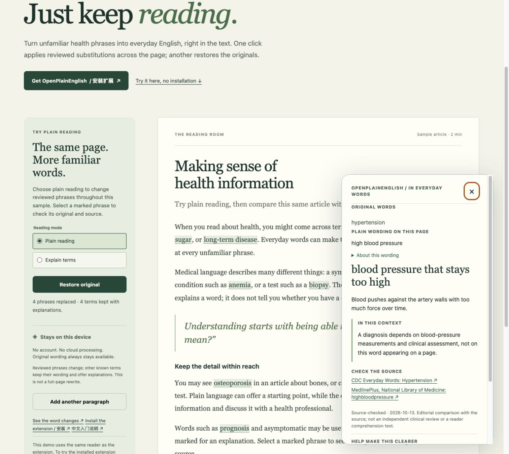

# OpenPlainEnglish v0.3.0 — verification record

Release date: 2026-10-13. This is a developer preview of reversible in-place reading assistance.

## Scope delivered

- **Plain reading:** replace eligible wording across supported page text using 40 explicit source-checked pairs from 21 of the 100 glossary entries.
- **Explain terms:** retain original words with accessible explanation markers; choose a mode while off without activating page access.
- **Original comparison and restore:** show actual matched text beside the replacement, restore untouched originals, preserve website edits and reconcile dynamic content.
- **Connected interfaces:** mode controls and separate counts in the popup and web demo; replacement-aware glossary search and existing local feedback/backup flows.
- **Distribution:** versioned ZIP and checksum, online demo, installation entrance, Chinese onboarding and updated store-submission materials.

Replacement coverage is deliberately narrower than explanation coverage. Definitions are never used automatically as substitutions. See the [exact replacement ledger](INLINE-LEXICON.md), examples, exclusions and review boundaries.

## Evidence

`npm run check` passed **112 tests**, lexicon validation and the extension build. `npm run build:site` and `npm run package` also passed. The checks cover bundled popup/background/content messages, every one of the 40 shipped replacement forms, conservative capitalization and compound boundaries, mode changes, restoration, host mutations, local feedback, backup imports and distribution integrity. The native extension host is not emulated by these tests.

Chrome loaded the static build beneath `/openplainenglish/`. Plain reading produced **4 replacements and 4 annotations** in the initial article. A keyboard action opened the original `hypertension` beside `high blood pressure` and its sources. Switching to Explain terms restored article text exactly with 8 markers. Adding a paragraph in Plain reading produced **5 replacements and 6 annotations**. Restore original removed all markers and preserved both the original article and the newly added paragraph byte-for-byte as DOM text. No console errors were observed in this flow.

The popup preview retained an off state when a mode was merely selected, switched its active state and reported explicitly labeled example counts. The actual bundled integration test separately exercised those messages against a real jsdom reader. Glossary search for `noncancerous growth` returned the benign-tumor entry with all four explicit pairs; its source disclosure and local feedback route worked. Preview browser APIs remain simulations.

The archive contains **16 declared files, 222,412 bytes**. Independent `unzip -t` and `shasum -a 256 -c` checks passed. ZIP SHA-256: `532fe6a21a37a444bf3819628e647ae769b1355aadf26aaa77fd1559bdeb0ae3`.

The [versioned release notes](https://github.com/jakezwang/openplainenglish/releases/tag/v0.3.0) record the publication commit, CI result and public-site verification after deployment. The local screenshot above is a web demo, not an installed-extension screenshot.

The live source check for this lexicon found all **105 unique cited URLs available** and **91 official term-presence probes successful**. Its machine-readable report is attached to the release as `source-audit-v0.3.0.json`, with input SHA-256 `69cdd086f57ae441512e597e2c4c8f8342b9b412ae2aa5705cb35370241dcfae`. Link availability and term presence do not establish factual accuracy. The separate inline editorial comparison read 25 primary citations for 23 candidates; 21 entries were retained.

## Outstanding external validation

- Native Chrome/Edge extension installation, activeTab permissions, service-worker execution, extension CSP and extracted-ZIP installation still require manual verification. Browser automation previously rejected access to the extension manager; no alternate route was used to bypass that restriction.
- Native file-picker import remains unverified because the browser tool lacked file-URL access. Automated import validation, preview, merge and cancellation tests are separate evidence.
- The owner has no Chrome Web Store developer account. Registration, applicable payment, declarations, native screenshots, submission and review remain pending. The developer-console action was rejected by automatic browser approval; no account, payment or submission occurred. The installation page accurately shows that store installation is unavailable.
- Independent clinical review, participant comprehension testing, screen-reader testing and broad real-site compatibility testing have not been completed. The source-checked label describes editorial source comparison only.

The [manual test guide](TESTING.md) and [store worksheet](STORE-SUBMISSION.md) provide concrete remaining steps. This release does not claim diagnosis, personal-record interpretation, translation, OCR, PDF support or automatic understanding of sentence context.
